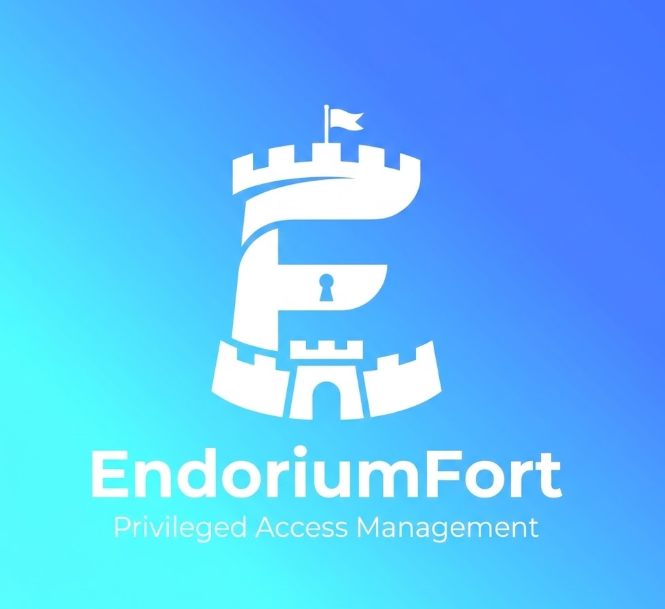

<p align="center">
  
</p>

<h1 align="center">EndoriumSpace</h1>

<p align="center">
  Site vitrine d'EndoriumFort — bastion PAM souverain et auto-hébergé.<br>
  Statique, sans dépendance, sans étape de build.
</p>

<p align="center">
  <a href="https://endorium.space"></a>
  
  
  
</p>

---

## Présentation

Site marketing du produit [EndoriumFort](https://github.com/Endorium-Group/EndoriumFort-CE),
en français. Le design reprend celui de l'UI du produit : mêmes tokens de
couleur, Space Grotesk et IBM Plex, accent bleu vers cyan, thème clair et
sombre.

Trois espaces s'ajoutent à la page d'accueil : la documentation, un fil de
questions communautaires, et les pages légales. Leur contenu est écrit en
Markdown et rendu côté client, donc ajouter une page ne demande aucune
recompilation.

---

## Structure

```
EndoriumSpace/
├── index.html          page d'accueil, toutes les sections
├── styles.css          système de design (clair + sombre)
├── main.js             thème, menu mobile, onglets, copie, animations
├── assets/
│   ├── logo-*.png      logos repris du produit
│   ├── app.css         styles des espaces docs/community/legal
│   ├── md.js           rendu Markdown côté client
│   └── sizing.js       calculateur de dimensionnement (section #sizing)
├── docs/
│   ├── index.html      espace documentation
│   └── content/        pages Markdown
├── community/
│   ├── index.html      liste des questions
│   ├── question.html   vue d'une question
│   └── data/           contenu des questions
├── legal/
│   ├── index.html      espace légal
│   └── content/        mentions, politiques
├── Dockerfile          image nginx servant le site
└── docker-compose.yml  service pour un reverse-proxy Caddy existant
```

---

## Aperçu local

Les chemins d'assets sont relatifs, donc n'importe quel serveur statique suffit.

```bash
python3 -m http.server 8080
# puis ouvrir http://localhost:8080
```

| Alternative | Commande |
|---|---|
| Node | `npx serve` |
| PHP | `php -S localhost:8080` |
| Caddy | `caddy file-server --listen :8080` |

Ouvrir `index.html` par `file://` casse le rendu Markdown des espaces `docs/`,
`community/` et `legal/` : il faut passer par un serveur HTTP.

---

## Démo interactive (`demo/`)
`/demo/` sert la vraie interface **EndoriumFort Enterprise** (dépôt privé
`NergYR/EndoriumFort`, version figée dans `.github/workflows/pages.yml`, seul `frontend/`
est récupéré), sans serveur : l'API est simulée dans le navigateur.

```
demo/
├── src/shim.js          # point d'entrée : intercepte fetch/WebSocket, sous-chemin, bandeau « Démo »
├── src/api.js           # API simulée (état en sessionStorage, réinitialisable)
├── src/shell.js         # terminal SSH / exec Kubernetes simulés, garde de commandes, enregistrement
├── src/host.js          # sorties des commandes des hôtes simulés
├── src/v56.js           # rapports (port de reporting.cc), transfert SSH, drive de fichiers
├── src/fixtures.json    # réponses enregistrées depuis un vrai bastion Enterprise
├── capture/             # régénère fixtures.json (voir capture/README.md)
├── vite.config.demo.mjs # build du frontend pour la démo (sources produit non modifiées)
└── build.sh             # demo/build.sh <checkout EndoriumFort> <sortie> [base]
```

- Connexion avec n'importe quel mot de passe : `admin`, `c.moreau` (opérateur), `s.lefevre` (auditeur).
- Simulé avec l'état de l'onglet : politiques JIT, profils, demandes et double validation,
  ouverture de session (motif, ticket, objectif, MFA), coffre (mot de passe injecté), terminal SSH
  et exec Kubernetes, garde de commandes, enregistrements rejouables, Session DNA et paquets de preuve
  (chaîne recalculée comme sur le bastion), journal, rapports d'activité (calculés sur le journal,
  avec 180 jours d'historique simulé), transfert de fichiers SSH, drive de fichiers et partages.
- Rejoué tel qu'enregistré : SSO, LDAP, SCIM, SIEM/ITSM, relais, cluster, ITDR, centre de sécurité.
- Non simulé : navigateur isolé (RBI), VNC et RDP (message explicite).
- Données 100 % fictives ; rien ne quitte le navigateur.

Build local :
```bash
git clone --depth 1 --branch v1.0.56 https://github.com/NergYR/EndoriumFort /tmp/ee   # accès requis
demo/build.sh /tmp/ee ./_site/demo /demo/
```

Après une montée de version : changer `EE_REF` dans le workflow, relancer la capture
(`demo/capture/README.md`) et vérifier la démo.

## Déploiement

### GitHub Pages (en place)
Le workflow `.github/workflows/pages.yml` publie le site + la démo à chaque push sur `master`
(ou à la main, avec un tag au choix) sur https://endorium-group.github.io/EndoriumSpace/.
Prérequis une seule fois :
- *Settings → Pages → Source : GitHub Actions* ;
- secret `EF_SOURCE_TOKEN` : jeton *fine-grained*, accès **lecture seule « Contents »** au seul
  dépôt `NergYR/EndoriumFort` (le workflow n'en récupère que `frontend/`).
`404.html` renvoie les liens profonds de la démo (ex. `/demo/sessions`) vers l'application.

### Hébergeur statique

N'importe lequel convient — Netlify, Vercel, Cloudflare Pages, GitHub Pages,
nginx. Il suffit de servir ce répertoire tel quel, racine comprise.

### Docker derrière un reverse-proxy Caddy

L'image fournie sert le site en HTTP ; Caddy termine le TLS.

```bash
docker network ls                  # relever le réseau de Caddy, ex. reverse_default
# ajuster `name:` dans docker-compose.yml si besoin
docker compose up -d --build
```

Bloc Caddyfile correspondant — le conteneur s'appelle `endoriumspace`, port 80 :

```
endorium.space {
    import tls_alpn_only
    reverse_proxy endoriumspace:80
}
```

Recharger ensuite Caddy (`caddy reload`, ou
`docker exec <caddy> caddy reload --config /etc/caddy/Caddyfile`). Pour publier
une mise à jour : `docker compose up -d --build`.

---

## À compléter avant mise en ligne

Les valeurs entre crochets sont des placeholders.

| Placeholder | Emplacement | Remplacer par |
|---|---|---|
| `[contact@votre-domaine]` | CTA et pied de page | l'adresse de contact réelle |
| `[lien-depot-public]` | pied de page | l'URL du dépôt CE |
| `[lien-documentation]` | pied de page | l'URL de la documentation |
| `[Mentions légales à compléter]` | `legal/content/` | les mentions légales |
| `og:image` | `index.html` | une URL **absolue**, sinon l'aperçu au partage est vide |
| URL de registre et de chart | section Déploiement | les URL réelles |

---

## Règles de contenu

Contraignantes : elles protègent la crédibilité du produit, et nous exposent
juridiquement si elles sont enfreintes.

- **Aucune fabrication** — pas de faux clients, logos, témoignages, chiffres ni
  certifications.
- **Conformité** — écrire « conçu pour s'aligner » ou « prêt pour l'audit »,
  jamais « certifié » : aucun audit tiers n'a été réalisé à ce jour.
- **Aucun secret réel** dans les exemples de code.

---

## Version anglaise

Le site est en français. Pour l'anglais : dupliquer `index.html` en
`en/index.html`, traduire, puis ajouter un sélecteur de langue dans l'en-tête.

---

## Liens

| Ressource | Lien |
|---|---|
| Produit (Community Edition) | [Endorium-Group/EndoriumFort-CE](https://github.com/Endorium-Group/EndoriumFort-CE) |
| Documentation produit | [docs/index.md](https://github.com/Endorium-Group/EndoriumFort-CE/blob/master/docs/index.md) |
| Site en production | [endorium.space](https://endorium.space) |
